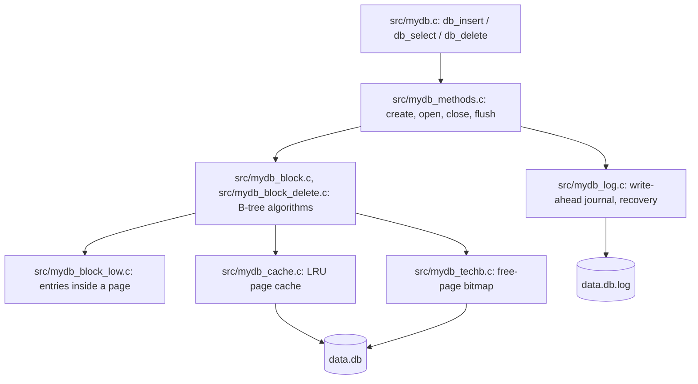
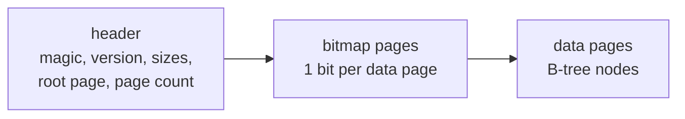
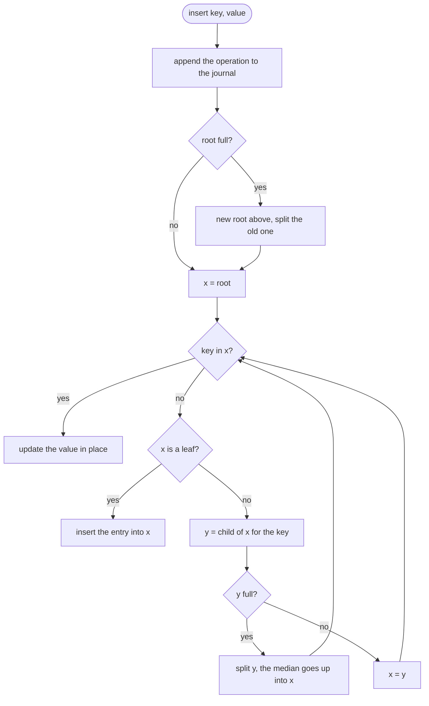
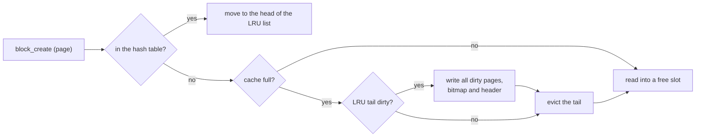
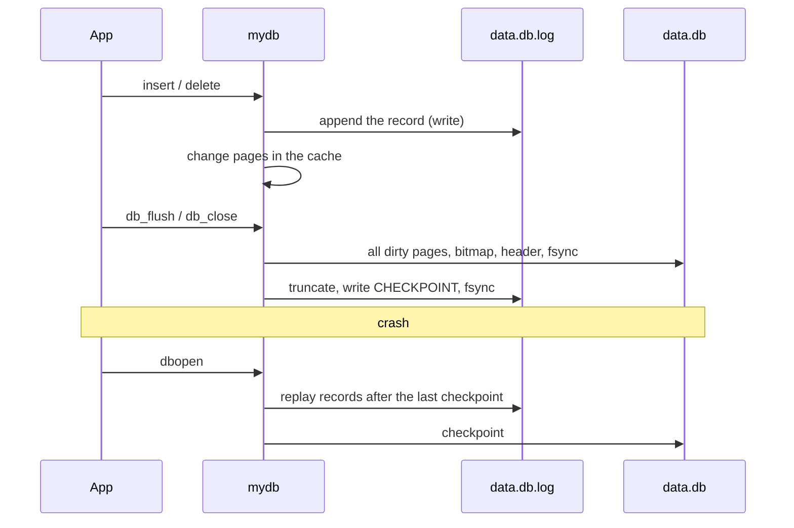

# mydb — a B-tree key-value storage in C

[](https://github.com/favorart/b-tree/actions/workflows/ci.yml)

A small embedded key-value storage: a single file of fixed-size pages
organized as a B-tree, with variable-length keys and values,
an LRU write-back page cache and a write-ahead journal for crash recovery.
Plain C99 and POSIX, no dependencies.

It was written in 2015 as a course project at Technosphere,
the educational project of Mail.Ru Group: a B-tree storage behind a given C API,
then a page cache and a journal on top of it. In 2026 it was brought back to life: it builds on modern compilers,
the bugs found by review and sanitizers are fixed, and the unfinished parts
(deletion and recovery from the journal) are completed and covered by tests.

## Features

- B-tree with keys and values of variable length stored right in the nodes
  (not a B+-tree): one page read per level on lookup.
- Insertion with proactive splits on the way down (one pass, CLRS style).
- Deletion: lazy, without node merging; see [Deletion](#deletion).
- Free-space bitmap for page allocation, pages are reused after deletes.
- LRU page cache with an open-addressing hash table and write-back of dirty pages.
- Write-ahead journal with checksummed records, checkpoints and replay on open.
- Tests against a reference model, including crash recovery; ASan/UBSan clean.

## Quick start

```bash
make                # build/libmydb.a and build/mydb_demo
./build/mydb_demo   # creates demo.db and demo.db.log
make test           # unit and integration tests
make SAN=1 test     # the same with AddressSanitizer + UndefinedBehaviorSanitizer
```

A POSIX system and a C99 compiler (CI runs gcc and clang on Ubuntu).
Run `make clean` before switching between `SAN=1` and a regular build.

## API

```c
#include "mydb.h"   /* include/, link with build/libmydb.a */

sDBC conf = { .db_size = 64 << 20, .page_size = 4096, .cache_size = 4 << 20 }; /* 0 = default */
sDB *db = dbcreate ("data.db", &conf);    /* or dbopen ("data.db") for an existing one */

db_insert (db, "key", 3, "value", 5);      /* insert or update */

void  *val;  size_t len;
if ( db_select (db, "key", 3, &val, &len) == 0 )  /* 0 - found */
{ /* use val[0..len) */ free (val); }     /* the value is malloc'ed */

db_delete (db, "key", 3);                  /* -1 if there is no such key */
db_flush  (db);                            /* checkpoint: pages to disk, journal truncated */
db_close  (db);                            /* flush + free */
```

The same operations are available as function pointers of `struct DB`
(`db->insert`, `db->select`, `db->delete`, `db->sync`, `db->close`) with `struct DBT { void *data; size_t size; }` arguments,
as required by the course API ([`include/mydb.h`](include/mydb.h), documented with doxygen comments).

| Function | Returns |
|---|---|
| `dbcreate (file, conf)` | a new database (the file is truncated), `NULL` on error |
| `dbopen (file)` | an existing database after recovery from the journal, `NULL` on error |
| `db_insert`, `db_delete`, `db_select`, `db_flush`, `db_close` | `0` on success, `-1` on error / key not found |
| `db_max_kv_size (db)` | the largest key + value size for this page size |
| `db_check (db)` | number of keys after checking the tree invariants, `-1` if broken |
| `db_stats (db, &st)` | the shape of the tree: height, pages, empty pages, fill (`sDBStat`) |
| `db_trace (level, out)` | the trace of the tree work, see [Debugging with the trace](#debugging-with-the-trace) |

Configuration (`sDBC`), a zero field takes the default:

| Field | Default | Limits |
|---|---|---|
| `db_size` | 512 MB | at least 3 pages, below 4 GB |
| `page_size` | 4 KB | at least 512 bytes |
| `cache_size` | 16 MB | at least 128 pages |

## Repository layout

| Path | Contents |
|---|---|
| [`include/`](include) | the public API: `mydb.h` (and `stdafx.h` with the common includes) |
| [`src/`](src) | the implementation and the internal headers |
| [`examples/demo.c`](examples/demo.c) | a small example of the API |
| [`tests/`](tests) | unit tests of the modules, integration tests against a model, the worst cases |
| [`bench/`](bench) | throughput benchmark |
| `build/` | build output (not in git) |

## Architecture



### File layout



The header (36 bytes) keeps the page size, the number of bitmap and data pages and the root page number.
The bitmap takes `ceil(pages / (8 * page_size))` pages, one bit marks a used data page.
Data pages are addressed by their index, child pointers are 32-bit page indices.

### Page layout

Every data page starts with a 20-byte header: node type (leaf / inner), number of keys,
own page index, free bytes and the leftmost child pointer. Then entries follow, sorted by key:

```text
| type | nkeys | offset | free | ptr0 | ksz | vsz | key | value | ptr1 | ksz | vsz | key | value | ptr2 | ... free ... |
                                     \_________ entry 1 _____________/ \_________ entry 2 ___________/
```

`ptr0` is the child with keys less than key 1, `ptrN` is the child between key N and key N+1 (unused in leaves).
Keys are compared with `memcmp`, then by length. Integer fields inside a page are unaligned
and are accessed with `memcpy`.

An entry (12 bytes + key + value) may take at most 1/8 of the page payload
(497 bytes of key + value for 4 KB pages), and a page counts as *full* when less than 1/4 of it is free.
Together these guarantee that a non-full page always has room for a key coming up
from a split child and for growing one of its entries.

### Insertion



A full page is split by bytes, not by the number of keys: the left half keeps entries
until it holds about a half of the used space, the next entry becomes the median.

### Deletion

Deletion follows the same rule "every page on the path is non-full" and never merges pages:

- a key in a leaf is removed, the leaf may become underfull or empty;
- a key in an inner page is replaced by its predecessor
  (the last key of the deepest non-empty page on the right spine of the left subtree),
  or by its successor if the left subtree is empty;
- if both neighbouring subtrees are empty, the key is removed with its right subtree and the pages are freed;
- an inner root without keys is dropped and the tree becomes lower.

All leaves stay at the same depth, but the pages are not rebalanced:
space is reused by later inserts, the file never shrinks. The price is measured in [Worst cases](#worst-cases).

### Page cache



Pages are looked up by number in an open-addressing hash table whose cells are linked
into the LRU list. Modified pages are only marked dirty and are written on eviction or checkpoint.

### Journal and recovery

Each `insert` / `delete` appends a record to `<file>.log` *before* changing the tree:

```text
| type u32 | key size u32 | value size u32 | LSN u64 | key | value | FNV-1a checksum u32 |
```



Why the replay is correct: dirty pages never reach the disk one by one.
When the cache has to evict a dirty page, it writes *all* dirty pages, the bitmap and the header together,
at a moment when the tree in memory is valid (between page fetches of an operation).
So the file always holds a consistent tree that reflects a prefix of the journal,
and insert/delete are idempotent: repeating the operations from the last checkpoint gives the same state.
A record torn by a crash is detected by its checksum and ignored.

## Tests

[`tests/test_mydb.c`](tests/test_mydb.c) checks every operation against a sorted-array model
and verifies the tree invariants with `db_check`:

- basic operations, updates, empty values, invalid arguments, foreign and missing files;
- 20–30 thousand random inserts / updates / deletes with the default cache and with the smallest
  cache (many evictions), with and without reopening, with 512-byte and 4 KB pages;
- deleting all keys and inserting them again (page reuse);
- filling the file completely;
- crash recovery: a child process runs operations and exits without closing the database,
  the parent reopens it and compares with the model, also with a torn journal tail.

`MYDB_CRASH_ROUNDS=20 make test` runs more crash rounds.

## Debugging with the trace

Instead of a debugger, the library can print what the tree is doing, one line per action:

```bash
MYDB_TRACE=2 ./build/mydb_demo                          # to stderr
MYDB_TRACE=4 MYDB_TRACE_FILE=trace.log ./your_program   # appended to a file
```

or `db_trace (MYDB_TRACE_TREE, stderr)` from the code. Levels:
1 — API operations, open, recovery, checkpoints;
2 — the path through the tree, splits, key replacements, root changes;
3 — page cache misses and evictions, page allocation, journal records;
4 — the contents of every changed page.
Every line starts with the operation number, so `grep "mydb #91 "` shows all actions of one call
(level 3, from `make test`):

```text
mydb #91 insert key="adbaccbdab" (10 B) value 2 B
mydb #91     journal: LSN 69 insert "adbaccbdab"
mydb #91     allocate page 1 (bitmap page 0, byte 0, bit 1), 2 pages used
mydb #91     cache miss page 1: free slot 1 of 32768
mydb #91     allocate page 2 (bitmap page 0, byte 0, bit 2), 3 pages used
mydb #91     cache miss page 2: free slot 2 of 32768
mydb #91   the root page 0 is full: new root page 1 above it, the tree grows
mydb #91   split leaf page 0 -> new page 2, median "cadccbcccdcdbdd" up into page 1 (8 + 4 keys)
mydb #91   page 1 inner, 1 keys, 436 B free -> child page 0
mydb #91   page 0 leaf, 8 keys, 282 B free: insert or update
mydb #91 insert done
mydb #148 delete key="cdcccabb" (8 B)
mydb #148     journal: LSN 126 delete "cdcccabb"
mydb #148   page 1 inner: the key is here, look for a neighbour key
mydb #148   page 1: replace "cdcccabb" by its predecessor "cccccdcaddbbabadaaa" from page 2
mydb #148 delete done
```

With the trace off a trace point costs one integer comparison.

## Performance

`make bench` (source: [`bench/bench_mydb.c`](bench/bench_mydb.c)) measures the throughput with 16-byte keys
and 32-byte values. 50 000 keys, gcc 11 `-O2`, WSL2 on a desktop CPU, one run:

| configuration | insert, sequential | insert, random | select, present | select, absent | update | delete, random |
|---|---:|---:|---:|---:|---:|---:|
| page 4K, cache 16M (the tree fits) | 319K ops/s | 186K | 594K | 634K | 302K | 405K |
| page 4K, cache 1M (does not fit) | 221K | 22K | 328K | 189K | 13K | 13K |
| page 16K, cache 16M | 158K | 228K | 275K | 230K | 236K | 250K |

A checkpoint (`db_flush`) takes 25–40 ms, mostly `fsync`.
When the cache is smaller than the tree, random modifications are about 10 times slower:
evicting a dirty page writes *all* dirty pages and calls `fsync` (see [Journal and recovery](#journal-and-recovery)) —
the price of the simple crash-consistency scheme. CI runs the benchmark on every push and shows the table in the job summary.

## Worst cases

[`tests/test_worst.c`](tests/test_worst.c) (a part of `make test`) runs the workloads that hurt this tree most,
checks the tree with `db_check` and prints its shape (`db_stats`) next to a *rebuilt* tree:
the same keys inserted into a fresh database in a random order — about what rebalancing would give.
`./build/test_worst 100000`, 512-byte pages, 9-byte keys, 16-byte values, the whole tree in the cache:

| case | keys | height | pages | empty pages | fill | lookup, us |
|---|--:|---|---|--:|---|---|
| random inserts (baseline) | 63230 | 6 / 6 | 9959 / 10336 | 0 | 48% / 46% | 0.47 / 0.41 |
| ascending inserts | 100000 | 7 / 6 | 19999 / 15789 | 0 | 38% / 48% | 0.57 / 0.49 |
| descending inserts | 100000 | 7 / 6 | 24994 / 15789 | 0 | 30% / 48% | 0.63 / 0.49 |
| delete 90% at random | 10007 | 7 / 5 | 12238 / 1592 | 8290 | 6% / 47% | 0.37 / 0.29 |
| keep every 100th key | 1000 | 7 / 4 | 2558 / 157 | 2002 | 3% / 48% | 0.24 / 0.22 |
| delete all but 10 keys | 10 | 7 / 1 | 14 / 1 | 10 | 5% / 75% | 0.19 / 0.05 |
| sliding window (a queue) | 5000 | 5 / 5 | 1005 / 788 | 5 | 37% / 48% | 0.28 / 0.29 |
| random insert/delete churn | 50050 | 6 / 6 | 12588 / 7948 | 764 | 30% / 47% | 0.47 / 0.40 |
| max-size values (vs 16-byte values) | 6334 | 6 / 5 | 1564 / 1266 | 0 | 50% / 38% | 0.34 / 0.28 |

Each cell: this tree / the rebuilt one. What it shows:

- **Mass deletes** are the worst case of the lazy deletion: after deleting 90% of the keys the tree keeps
  7.7 times more pages, two thirds of them empty, and two extra levels.
  Rebalancing (merging and borrowing on delete) would keep the fill near the rebuilt one and lower the tree:
  2 page reads less per lookup on a cold cache. The freed pages are reused by later inserts,
  but the file never shrinks.
- **Churn** (random inserts and deletes) slowly lowers the fill: 30% against 47%; merges would help here too.
- **Ascending and descending inserts** are not about deletion: a page is split in two halves, so the left (right)
  halves stay half-full forever. Rebalancing on delete does not help; a split at the insertion point
  for sequential inserts would (pages near 100%).
- **The baseline fill is about 50%**, not the usual 69% of a B-tree: a page counts as full at 75%
  (a quarter is kept for a median and an entry growth, see [Page layout](#page-layout)).
- With the tree in memory a lookup costs little either way (at most 1.3 times slower):
  the difference is in the page reads when the cache is cold and in the disk space.

## Limitations

- Single-threaded, one process at a time; no file locking.
- Durability against a process crash, not against a power loss:
  journal records are written without `fsync` (only checkpoints are synced),
  and a crash in the middle of writing the pages can leave the file inconsistent (no double-write buffer).
- Key + value size is limited by the page size (1/8 of a page); empty keys are not allowed.
- No range scans or iterators; pages are not merged after deletes, the file does not shrink.
- Integers are stored in the native byte order (the files are not portable between endiannesses).
- Fatal I/O errors inside the cache terminate the process (`exit`), as in the original code.

## Versions and releases

The library follows semantic versioning: `MYDB_LIB_VERSION_STRING` in [`include/mydb.h`](include/mydb.h).
Pushing a tag `vMAJOR.MINOR.PATCH` that matches it builds and tests the code and publishes
a GitHub release with `include/` and `libmydb.a` for Linux x86-64.
Only the 3 latest releases are kept; older tags stay in git.
The on-disk format has its own number (`MYDB_VERSION`): files of another format are rejected.

## History

What the 2015 code was, what was changed in 2026 and why, with the measurements (in Russian):
[`docs/history.ru.md`](docs/history.ru.md).

## License

[GPL-2.0](LICENSE)
