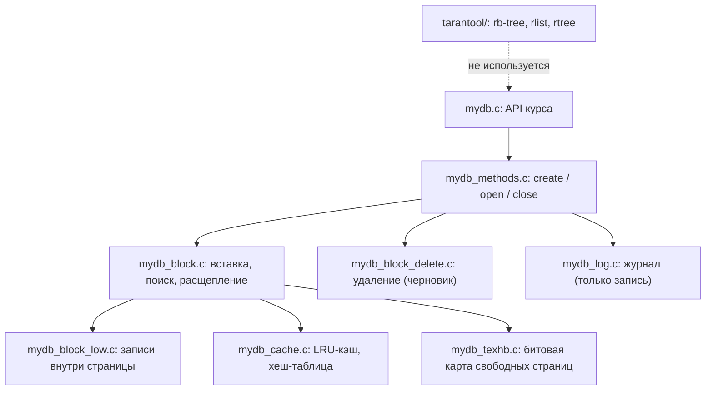

# mydb: каким был код в 2015 году и что с ним стало

Документ для автора и читателей репозитория. В нём три части:

1. исходный код 2015 года: что он делал, сильные и слабые стороны;
2. изменения 2026 года по темам, со ссылками на коммиты;
3. итоговое состояние: возможности, цифры, сильные и слабые стороны, что делать дальше.

## 1. Исходный код (2015)

Курсовой проект Техносферы Mail.Ru: хранилище «ключ — значение» на B-дереве за заданным C API
(`dbcreate`, `dbopen`, `db_insert`, `db_select`, `db_delete`, `db_close`). Сначала — само дерево,
затем страничный кэш и журнал. Около 3 500 строк на C, последний коммит — `ac53d0c`.

### Что было сделано и работало по замыслу

- **Формат файла:** заголовок, битовая карта свободных страниц, страницы-узлы фиксированного размера.
- **Узлы B-дерева, а не B+.** Ключи и значения переменной длины хранятся прямо в узлах.
  Запись — `| ksz | vsz | key | value | rptr |`.
- **Вставка по CLRS:** полный узел расщепляется заранее, на спуске, за один проход. Расщепление идёт
  по байтам, а не по числу ключей.
- **Поиск** — спуск от корня, по одной странице на уровень.
- **LRU-кэш страниц:** хеш-таблица с открытой адресацией, ячейки связаны в LRU-список,
  отложенная запись грязных страниц.
- **Журнал (WAL):** у записей LSN, тип операции, ключ и значение, есть чекпоинт.
- **Комментарии с ASCII-схемами** всех случаев удаления по CLRS: замена предшественником или
  последователем, повороты влево и вправо, слияние, цикл спуска без рекурсии.

### Чего не хватало и что было сломано

| Область | Состояние в 2015 |
|---|---|
| Сборка | не линковалась современным gcc: `mydb_errno` определялась в заголовке; двойные `typedef` (C11) |
| Удаление | черновик: ветки для внутренних узлов закомментированы, в листе не уменьшался счётчик ключей |
| Восстановление | журнал писался, но не читался при открытии; читатель разбирал поля в неверном порядке |
| Битовая карта | не записывалась на диск: после переоткрытия все страницы казались свободными и перезаписывались |
| Размер карты | считался в байтах вместо страниц: 64 МБ памяти на файл в 512 МБ |
| Кэш | сброс пропускал хвост LRU; на дереве больше кэша хеш-таблица теряла страницы, и появлялись две копии одной страницы |
| Корень | пустой корень не записывался: открытие пустой базы завершало процесс |
| Ключи | длина следующего ключа читалась как 1 байт (ключи длиннее 255 байт ломались); `key_compare` читал за границей короткого ключа |
| Запись | `block_change` писал правый указатель не туда; обновление ключа из внутреннего узла вставляло дубликат в лист |
| Невыровненный доступ | `uint32` внутри страницы читались по невыровненным адресам (UB) |
| Проверки | не было ограничения на размер записи: большая запись могла не поместиться при расщеплении |
| Тесты, CI | нет; отладка — `printf` под `_DEBUG`, `_DEBUG_CACHE`, `_DEBUG_TECHB` |

### Сильные и слабые стороны исходного кода

**Сильные:**
- продуманная архитектура: модули страницы, дерева, кэша, карты и журнала разделены;
- ключи и значения переменной длины прямо в узлах — один поиск читает одну страницу на уровень;
- вставка за один проход, расщепление по байтам;
- собственный кэш с хеш-таблицей и LRU без внешних зависимостей;
- подробные ASCII-схемы алгоритма удаления.

**Слабые:**
- код не собирался и не был доведён: удаление и восстановление — заготовки;
- ошибки в каждом модуле, часть из них портит данные после переоткрытия;
- без тестов ошибки оставались незамеченными;
- отладка только печатью при пересборке с макросами.

## 2. Что изменено (2026)

История `master` переписана так, чтобы каждый коммит был одним законченным изменением.
Оригинал сохранён в истории до `ac53d0c`.

### 2.1. Сборка, формат, раскладка

- **`86697ed` — сборка и CI.** `extern` для `mydb_errno`, `Makefile` с `-Wall -Wextra`,
  GitHub Actions собирает код gcc и clang. Это минимальная правка, после которой код 2015 года собирается.
- **`81b557d` — формат и перевод.**
  - UTF-8 без BOM, LF (два комментария были в CP1251);
  - `clang-format`;
  - русские комментарии переведены на английский построчно, поэтому ASCII-схемы сохранили форму.
- **`951e3e1` — раскладка.** `include/` — публичный API, `src/` — реализация, `examples/` — демо;
  сборка в `build/`. Неиспользуемый `tarantool/` удалён, `mydb_texhb.c` переименован в `mydb_techb.c`.

### 2.2. Исправления, удаление, восстановление (`bdcc7ff`)

Один коммит: исправления меняют общий интерфейс страниц (указатели на детей возвращаются по значению,
страницы принадлежат кэшу, у `sDB` новые поля), поэтому по отдельности модули не собираются.

- **Все ошибки из таблицы выше исправлены.**
- **Размер записи ограничен.** Запись — не больше 1/8 страницы, а страница «полная» при свободных ≤ 1/4.
  Поэтому в неполной странице всегда помещается медиана снизу и рост одной записи.
- **У заголовка есть магическое число и версия формата;** чужой файл не открывается и не портится.
- **Удаление — ленивое,** без слияния страниц:
  - путь от корня держится неполным, как при вставке;
  - ключ из листа просто удаляется;
  - ключ из внутреннего узла заменяется предшественником (или последователем);
  - пустые поддеревья освобождаются, пустой внутренний корень снимается.
- **Ваши схемы классического удаления CLRS** (повороты, слияние, цикл спуска) сохранены комментарием
  в `src/mydb_block_delete.c` как справка; повороты и слияние реализованы позже, в #13 (раздел 3.3).
- **Журнал переписан:**
  - на операцию одна запись с контрольной суммой FNV-1a;
  - чекпоинт = все страницы на диск + `fsync` + обрезка журнала;
  - при открытии повторяются операции после последнего чекпоинта; оборванный хвост игнорируется.
- **Правило целостности после сбоя.** Грязная страница никогда не пишется одна: при вытеснении
  пишутся все грязные страницы, карта и заголовок вместе. Поэтому на диске всегда целое дерево,
  а повтор журнала над ним корректен (операции идемпотентны).
- **`db_check()`** проверяет инварианты дерева.

### 2.3. Тесты

- **`e9dfbb8` — интеграционные тесты.**
  - Каждая операция сверяется с моделью — отсортированным массивом.
  - Тысячи случайных операций с крошечным и обычным кэшем, переоткрытие, страницы 512 Б и 4 КБ,
    удаление всего, заполнение файла целиком.
  - Сбой в дочернем процессе (`fork` + выход без закрытия), в том числе с оборванным хвостом журнала.
  - CI гоняет всё с ASan/UBSan.
- **`#3` — юнит-тесты модулей:** 16 тестов, около 4 700 проверок.
- **`#2` — найденная юнит-тестом ошибка кэша.** После серии вытеснений хеш-таблица теряла страницу,
  и та загружалась второй раз — две расходящиеся копии одной страницы. Исправлено: вставка и удаление
  по Кнуту (алгоритм R, обратный сдвиг) с переносом LRU-связей.

### 2.4. Инструменты

- **`#5` — бенчмарк** (`make bench`, отдельный джоб CI).
- **`#8` — трассировка вместо отладочных печатей.**
  - `MYDB_TRACE=1..4` или `db_trace()`; каждая строка начинается с номера операции API.
  - Уровни: операции и восстановление → путь по дереву, расщепления, замены ключей, рост и снижение корня →
    промахи и вытеснения кэша, выделение страниц, записи журнала → содержимое каждой изменённой страницы.
  - Выключенная точка трассировки стоит одно сравнение.
  - Вместо `_DEBUG`-печатей; дамп таблицы кэша (печатал жёстко заданный диапазон ячеек) удалён.
- **`#9` — `db_stats()` и тесты худших случаев** (раздел 3.3).
- **`#12` — расщепление в точке вставки** для последовательных ключей (раздел 3.3).
- **`#13` — перебалансировка при удалении:** слияние и заём у соседа по вашим схемам CLRS, в байтах (раздел 3.3).

### 2.5. Приведение к правилам репозиториев

- **Настройки репы:** только squash-мерж, Actions только GitHub-owned, токен на чтение, Dependabot,
  обязательные проверки CI и 1 одобрение (владелец вливает с обходом).
- **`#15` — CI:** отмена старых прогонов PR, изменения только документации без сборки, таймауты,
  бенчмарк только на `master`, macOS (Apple Clang). Каждый пуш в `master` с зелёным CI получает
  следующий патч-тег и релиз с `include/` и `libmydb.a` для Linux и macOS; хранятся 3 последних.
  Версия вычисляется из тега при сборке: `db_version()` возвращает `git describe` (`0.0.5`,
  `0.0.5-3-gabc1234`). До 0.0.4 версия жила в `mydb.h`, и тег ставился руками.
- **`#16` — `-Wpedantic` и без `stdafx.h`:** публичный заголовок самодостаточен, общее для реализации —
  в `src/mydb_common.h`; неиспользуемые ветка под Windows, `SWAP`, `HFILE`, `O_BINARY` удалены.
- **`#17` — тесты на cmocka** вместо самописной обвязки: каждый сценарий — отдельный тест,
  cmocka из системных пакетов.

## 3. Что стало

### 3.1. Возможности

- Вставка, обновление, поиск, удаление ключей и значений переменной длины (до 1/8 страницы).
- Переиспользование освобождённых страниц через битовую карту.
- Восстановление после падения процесса по журналу.
- Проверка дерева (`db_check`), статистика (`db_stats`), трассировка (`db_trace`).
- C99 + POSIX, без зависимостей (тестам нужна cmocka); CI на gcc и clang под Linux с санитайзерами и без,
  Apple Clang под macOS; Windows не поддерживается.

### 3.2. Скорость

`make bench`: 50 000 ключей по 16 Б, значения по 32 Б, gcc 11 `-O2`, WSL2.

| Конфигурация | Вставка подряд | Вставка вразброс | Поиск | Обновление | Удаление |
|---|--:|--:|--:|--:|--:|
| страница 4К, кэш 16М (дерево в памяти) | 319K оп/с | 186K | 594K | 302K | 405K |
| страница 4К, кэш 1М (не помещается) | 221K | 22K | 328K | 13K | 13K |

Когда дерево больше кэша, случайные изменения медленнее примерно в 10 раз. Вытеснение грязной страницы
пишет все грязные страницы и вызывает `fsync`. Это цена простой схемы целостности.

### 3.3. Худшие случаи, расщепление и перебалансировка

`./build/test_worst 100000`: страницы 512 Б, дерево в памяти. В ячейках — «было → стало»:
сначала ленивое удаление и деление страницы пополам, затем расщепление в точке вставки
и перебалансировка при удалении. Последний столбец — те же ключи, вставленные заново в свежую базу.

| Случай | Высота | Страниц | Пустых | Заполнение | Свежая база |
|---|---|---|---|---|---|
| случайные вставки (база) | 6 → 6 | 9 959 → 10 006 | 0 → 9 | 48% → 48% | 46% |
| вставки по возрастанию | 7 → 5 | 19 999 → 11 111 | 0 → 0 | 38% → 68% | 47% |
| вставки по убыванию | 7 → 5 | 24 994 → 11 111 | 0 → 0 | 30% → 68% | 47% |
| удалить 90% случайно | 7 → 5 | 12 238 → 2 607 | 8 290 → 0 | 6% → 29% | 47% |
| оставить каждый сотый | 7 → 4 | 2 558 → 266 | 2 002 → 0 | 3% → 28% | 48% |
| оставить 10 ключей | 7 → 2 | 14 → 3 | 10 → 0 | 5% → 25% | 75% |
| скользящее окно (очередь) | 5 → 4 | 1 005 → 559 | 5 → 0 | 37% → 67% | 47% |
| случайные вставки и удаления | 6 → 6 | 12 588 → 9 131 | 764 → 0 | 30% → 41% | 47% |

**Расщепление в точке вставки.** Если новый ключ больше (меньше) всех ключей крайнего правого (левого)
ребёнка, медианой становится последняя (первая) запись: полная страница остаётся полной, следующие ключи
заполняют новую. Вставки по порядку: заполнение 30–38% → 68%, страниц почти вдвое меньше, дерево ниже
на 2 уровня. Случайные вставки не изменились: у края делится только крайний ребёнок.

**Перебалансировка при удалении** — ваши схемы CLRS, но в байтах. Перед спуском в ребёнка, заполненного
меньше чем на четверть, он сливается с соседом и ключом-разделителем, если всё помещается в одну неполную
страницу, или занимает записи у соседа через родителя. Пустых страниц больше нет; после удаления 90% ключей
страниц в 3,4 раза меньше, заполнение 6% → 29%, дерево на 2 уровня ниже. До свежей базы (47%) не дотягивает
по построению: страница исправляется, только когда падает ниже четверти, — это минимальное заполнение
B-дерева с порогом 1/4.

**Как сохранена целостность после сбоя:** все три страницы (родитель и два ребёнка) загружаются до первого
изменения, а после исправления удаление начинается заново от корня — так каждая страница на пути снова
неполная. Под ASan/UBSan, с крошечным кэшем и в тестах сбоя всё проходит.

**Что осталось:** базовое заполнение около 50% вместо обычных для B-дерева 69% — страница считается полной
уже при 75%, четверть оставлена под медиану и рост записи. Поиск в памяти почти не меняется (разница
не больше 1,3 раза); выигрыш — в чтениях с диска и в месте на диске.

### 3.4. Сильные и слабые стороны сейчас

**Сильные:**
- корректность подтверждена тестами против модели, тестами сбоев и санитайзерами;
- целостность после падения процесса без сложной схемы: «все грязные страницы вместе» + идемпотентный журнал;
- страницы заполнены не меньше чем на четверть при любых удалениях, вставки по порядку — на две трети;
- можно отлаживаться без отладчика: трассировка по уровням, `db_check`, `db_stats`;
- исходная архитектура и ваши схемы сохранены, история читается по коммитам;
- CI, релизы по тегам, документация с диаграммами.

**Слабые:**
- заполнение около 50% при случайных вставках (порог «полной» страницы — 75%);
- файл не уменьшается после удалений: освобождённые страницы только переиспользуются;
- когда дерево больше кэша, вытеснение грязной страницы стоит полного сброса с `fsync` (в 10 раз медленнее);
- защита только от падения процесса, не от отключения питания: записи журнала без `fsync`,
  нет буфера двойной записи;
- один поток, один процесс, без блокировок файла; нет диапазонных запросов и итераторов;
- целые числа в файле в порядке байтов машины: файл не переносится между архитектурами;
- фатальные ошибки ввода-вывода в кэше завершают процесс (`exit`), как в исходном коде.

### 3.5. Что делать дальше

1. **Журнал вместо полного сброса при вытеснении:** писать страницу в журнал (физическое логирование),
   чтобы не делать `fsync` всего кэша.
2. **Итератор и диапазонный поиск** (`db_scan`).
3. **Офлайн-уплотнение `db_compact()`:** перестроить дерево в новый файл и уменьшить его.
4. **Порядок байтов little-endian в файле** — переносимость.
